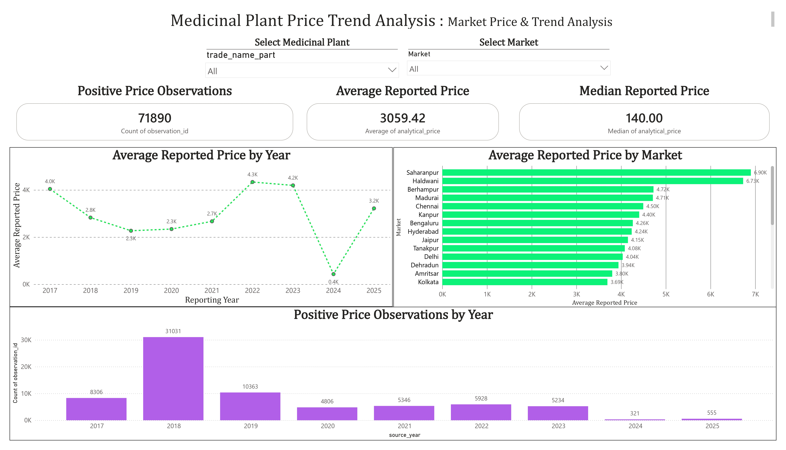
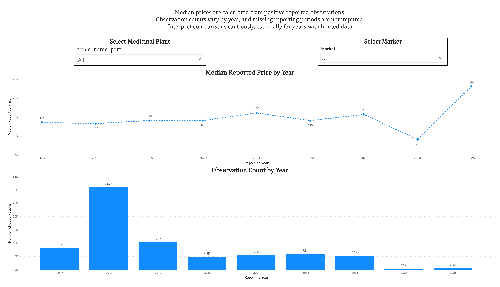

# Medicinal Plant Price Trend Analysis
### Market Price Analysis and Sourcing Insights

A data analytics and business intelligence project exploring historical medicinal plant market-price records to understand price distributions, market-level differences, reporting coverage, and potential sourcing insights.

## Project Overview

Medicinal plant prices may vary across plants, plant parts, markets, and reporting periods. This project organizes historical market-price records and applies data-quality assessment, exploratory data analysis (EDA), SQL, spreadsheet analysis, and business intelligence to investigate those differences.

**Primary Business Question**

How can medicinal-herb businesses use historical market prices, market information, and product characteristics to identify price variations, evaluate potential sourcing opportunities, and make better-informed purchasing decisions?

The project focuses on descriptive analytics and business intelligence, not machine learning or deep learning.

## Data Source and Scope

- **Source:** [e-CHARAK Price Wise](https://echarak.ayush.gov.in/Pricewise), Ministry of AYUSH, Government of India
- **Study period:** 2017–2025
- **Primary tools:** Python, Pandas, MySQL, Excel, and Power BI
- **Analytical dataset:** `medicinal_plant_prices_analytical.csv`
- **Database:** `medicinal_plant_price_trend_analysis`

The project uses annual Excel workbooks and retains source-period metadata and original price representations for traceability.

The analytical dataset contains **374,830 observations and 17 columns**. Structural and data-quality checks were performed, but validation does not establish that every source price is accurate or directly comparable.

## Work Completed

- Audited source workbooks and worksheets.
- Assessed reporting-period coverage.
- Restructured the source data into long format.
- Classified price representations and documented cleaning decisions.
- Created cleaned and analytical datasets.
- Investigated zero values and unusually high reported prices.
- Validated dataset structure and selected record-level conditions.
- Conducted exploratory analyses of plant-market coverage, price distributions, outliers, timelines, and price changes.
- Consolidated EDA findings and audited supporting reports.
- Designed a normalized MySQL schema with separate plant and price-observation tables.
- Imported and validated 374,830 observations, including checks for missing prices, duplicate candidate keys, and plant-market coverage.
- Analyzed Neem-Leaf monthly median prices across Berhampur, Kolkata, and Silliguri, with visualizations and documented data-quality caveats.
- Built a two-page interactive Power BI dashboard with plant and market filters, KPI cards, price-trend charts, and observation-coverage analysis.
- Documented the dashboard and published its report file and screenshots in the repository.

## Power BI Dashboard

The interactive Power BI report provides an overview of reported medicinal plant prices and a focused view of historical price trends.

### 1. Dashboard Overview



The Overview page presents key metrics and comparisons, including:

- Positive price observation count
- Average and median reported prices
- Average reported price by year
- Average reported price by market
- Positive observation count by year

Plant and market selectors allow users to explore subsets of the available data.

### 2. Plant Price Trend Analysis



The Plant Price Trend Analysis page focuses on historical price patterns and reporting coverage.

It includes:

- Median reported price by year
- Observation count by year
- Plant and market filters
- Data-quality and interpretation notes

Median prices help reduce the influence of extreme observations. Observation counts provide additional context when interpreting trends across years.

### Dashboard Files

- **[Power BI report](powerbi/Medicinal_Plant_Trend_Analysis.pbix):** Download and open the interactive report in Power BI Desktop.
- **[Dashboard documentation](reports/powerbi_dashboard_documentation.md):** Review the objectives, KPIs, data model, visualizations, usage instructions, and limitations.

## Repository Structure

```text
Medicinal-Plant-Market-Business-Intelligence/
├── notebooks/
│   └── 06_neem_leaf_visualization.py
├── powerbi/
│   ├── Medicinal_Plant_Trend_Analysis.pbix
│   ├── dashboard_overview.jpg
│   └── plant_price_trend_analysis.jpg
├── reports/
│   ├── charts/
│   ├── data_cleaning_policy.md
│   ├── data_quality_report.md
│   ├── data_source_notes.md
│   ├── neem_leaf_market_analysis.md
│   └── powerbi_dashboard_documentation.md
├── sql/
│   ├── plants.sql
│   ├── plants_staging.sql
│   ├── price_observations.sql
│   ├── price_observations_staging.sql
│   └── data_testing_*.sql
├── src/
├── requirements.txt
├── .gitignore
└── README.md
```

This structure highlights the main published project components. Raw source workbooks, processed datasets, and most intermediate CSV/TXT outputs are maintained locally and excluded from Git.

## Environment Setup

### 1. Clone the Repository

```bash
git clone https://github.com/DhaanushK/Medicinal-Plant-Market-Business-Intelligence.git
cd Medicinal-Plant-Market-Business-Intelligence
```

### 2. Create and Activate a Virtual Environment

On Windows:

```bat
python -m venv .venv
.venv\Scripts\activate
```

### 3. Install Dependencies

```bat
python -m pip install -r requirements.txt
```

### 4. Prepare the Data

The source Excel workbooks and generated datasets are not included in the repository. Place the required source workbooks in the local data directories expected by the relevant scripts.

Inspect each script's input and output paths before running it. Execute scripts in their intended workflow order because later stages may depend on files generated earlier.

## MySQL Setup and Analysis

The project uses a MySQL database named `medicinal_plant_price_trend_analysis`, with separate tables for plant names and price observations.

SQL scripts for table creation, staging, and data testing are available in the `sql/` directory.

The staging import script includes an example path placeholder. Before using it:

1. Replace the placeholder with the absolute path to your local import CSV.
2. Verify that `LOCAL INFILE` is enabled for both the MySQL server and client connection.
3. Review the target table and existing data before running an import script.

**Important:** Do not rerun a script containing `TRUNCATE TABLE` against a staging table whose contents you need to preserve.

## Neem-Leaf Visualization

The script `notebooks/06_neem_leaf_visualization.py` generates charts from a CSV exported from MySQL Workbench.

### Steps to Run

1. Execute the SQL query used to summarize monthly Neem-Leaf prices for Berhampur, Kolkata, and Silliguri.
2. Export the query result to `reports/neem_leaf_monthly_market_trends.csv` with these columns:

   - `market`
   - `source_year`
   - `reporting_month`
   - `reporting_month_name`
   - `positive_observations`
   - `monthly_median_price`

3. Install the dependencies and run:

   ```bash
   python notebooks/06_neem_leaf_visualization.py
   ```

The script writes the generated charts to `reports/charts/`.

The exported CSV is not committed to the repository, so it must be recreated locally before running the visualization script.

## Data Quality and Interpretation

The source data has incomplete reporting periods and multiple price representations. Some special values have no verified official definition in the project documentation.

The project follows these principles:

- Blank source cells are treated as missing, not zero.
- Unverified special representations are preserved or flagged rather than assigned unsupported meanings.
- The 168 zero values in the `Dec 2025 - 1` worksheet are flagged as **presumed missing**, based on source inspection. This is not an officially confirmed definition.
- High-value observations are flagged for investigation rather than automatically deleted.
- Missing reporting periods are not filled with invented observations.
- Reported prices are not assumed to have a verified unit or to be directly comparable across all products and markets.

### Outlier Handling

A reported Neem-Leaf price of 40,240 for Kolkata in June 2023 was retained because it was present in the source workbook. Its unit and context have not been independently verified.

This observation can substantially affect averages. Median-based summaries provide a more robust description of typical reported values, but they do not establish whether an observation is correct.

### Limitations for Sourcing Decisions

A lower reported price alone does not prove that a sourcing opportunity is commercially better. Product comparability, quality, transport costs, availability, and other purchasing factors require separate evidence.

Incomplete reporting coverage, missing prices, unverified units, and extreme observations limit direct comparisons across markets and years. Dashboard findings should therefore be interpreted as descriptive insights into the available reported data, not verified market quotations or guaranteed purchasing recommendations.

## Planned Work

- Translate supported analytical findings into practical business recommendations.
- Investigate additional factors needed for sourcing decisions, including product comparability, quality, transport costs, and reporting coverage.

## Reproducibility

The repository contains selected analysis scripts, SQL scripts, charts, the Power BI report, and supporting documentation. Raw source files, generated datasets, and large intermediate outputs are excluded from Git to avoid unnecessary size and duplication.

Follow the setup instructions to prepare the required local data and recreate the CSV input needed for the Neem-Leaf visualization script.

Refer to the reports directory for the documented analytical findings, assumptions, data-cleaning decisions, and limitations.

The project analyzes historical reported prices. Incomplete coverage, inconsistent reporting, and unverified units limit direct comparisons and conclusions about sourcing opportunities.
